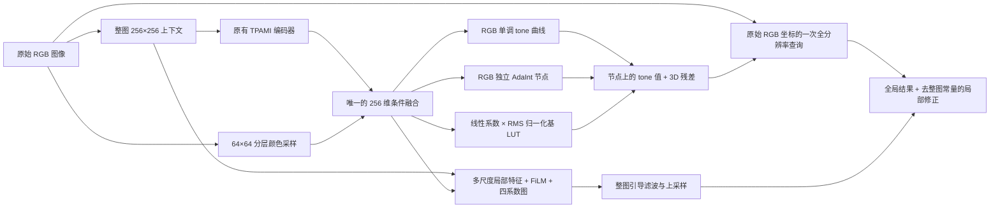

**本分支唯一模型：AiLUT，全局 tone/AdaInt LUT ＋局部仿射修正**

适用分支：`feature/global-affine__from_lut-refinement`。本次实施依据“分析 PPR10K 训练效果下滑”对话的最后一轮优化方案。当前只注册一个图像增强模型 `AiLUT`；BAN 使用相同架构的冻结教师，不另设模型类。

**完整前向路径**

1. **条件输入。** 整图缩放到 256×256，继续使用原分支的随机初始化 TPAMI backbone：5 个 stride=2 卷积块、Dropout、2×2 池化，产生 512 维全局特征。没有更换 backbone、预训练、数据输入版本或训练周期。另从完整图像分层采样 64×64 个像素，形成 RGB＋亮度各 16-bin 软直方图、均值、标准差、暗部/亮部比例和饱和度统计，共 82 维。两者经过一次 ConditionEncoder，得到 256 维条件。

2. **tone 与 AdaInt。** tone head 为 256→128→48：每个 RGB 通道预测 16 个正增量，经 softmax 和累加生成 17 个曲线节点，端点固定为 0、1，初始恒等。AdaInt head 为 256→128→96，分别生成 RGB 三轴各 32 个区间；区间公式为 `0.001 + (1 - 32×0.001)×softmax(logits)`。每轴得到 33 个严格递增节点，初始均匀。最小间隔还使真实斜率正则具有数值保护。

3. **完整全局 LUT。** 5 张独立、可学习的 RGB 33³ 基 LUT，不再先学习 17³ 再插值。每张基 LUT 按整个 RGB 体积计算 RMS，并归一化到单位 RMS。系数 head 为 256→128→5，输出线性、有符号、无 tanh/softmax 边界的系数。基 LUT 非零且不同，系数从小随机值开始，避免双零乘积。线性系数不再因趋近 ±1 而丢失梯度；仍需要实际训练验证其稳定性和泛化。

   在 AdaInt 实际节点构建融合 LUT：

   `L_X[b,g,r] = [T_R(V_R[r]), T_G(V_G[g]), T_B(V_B[b])] + Σ_m a_m(X) B̂_m[b,g,r]`。

   直接用原始 RGB 查询 `L_X`，得到 `y_global`。tone 改变 LUT 数值，避免先改变像素颜色、再改变后级采样坐标的级联耦合。tone 与 3D 残差仍有表示重叠；本实现把 tone 作为先验，没有强制 3D 残差不能表达一维变化。最终映射的端点和单调性也不是硬约束。

4. **直接局部修正。** 整图上下文缩到 128×128；浅层得到 16×64×64，深层得到 32×32×32，再上采样与浅层融合为 32×64×64。条件通过 FiLM 预测每通道 gamma、beta，在 `(1+gamma)×feature+beta` 后接非线性。1×1 输出层产生 4 张 64×64 系数图：一个共同增益 `a` 和 RGB 三个偏移 `b`。输出层零初始化，初始局部修正为零，但输出层直接收到重建梯度，不依赖两个专家先产生差异。为去掉恒定偏移参数的无效自由度，输出卷积不带 bias。

   在整图低分辨率亮度上进行引导滤波，得到可上采样的场；先滤完整场再按归一化 crop 坐标采样，最后以目标像素亮度重建系数：

   `raw_delta(p) = a(p)×y_global(p) + b(p)`；`y(p)=y_global(p)+raw_delta(p)-mu_context`。

   **整图常量的定义：** `mu_context` 在完整上下文的固定 64×64 网格上计算，训练 crop、验证、推理和教师共用同一定义。为此额外对该小网格做一次 LUT 查询。每张图总共是一遍目标分辨率查询＋一遍 64×64 查询，没有多张全分辨率专家 LUT 查询。上下文网格的局部修正均值严格为零；native 分辨率的均值是这个全图积分的近似，不能声称 native 每个像素精确零均值。它不是按随机 crop 重新中心化。

5. **输出与评价。** 训练直接优化浮点输出，不在模型末尾裁剪以免丢失越界输出的梯度；保存和指标计算沿用项目的 `tensor2img` 路径。保留逐图 PSNR、deltaE、PSNR_hc、deltaE_hc 以及不同原生尺寸的批量评估逻辑。人像 mask 仅用于 HC 评价，没有加入可选的人像辅助监督。

**相对于改前的实际变化**

| 项目 | 改前当前 V3 配置 | 改后唯一 AiLUT |
|---|---|---|
| 可选模型 | 原 AiLUT、KD、V2、RefinementBase、V3、GlobalLocal | 一个 AiLUT，BAN 同架构 |
| tone 位置 | 先变换输入像素，再查残差 LUT | tone 在真实节点上融入全局 LUT |
| 全局条件 | 原始统计融合＋tone 后再次统计融合 | 一次整图条件融合 |
| 基 LUT | 共享 4×RGB×17³，插值到 33³ | 5×RGB×33³ 独立节点，RMS 归一化 |
| 系数 | vertex embedding＋有界 tanh router | 直接线性有符号系数 |
| 局部处理 | 两专家 softmax 混合／另一个 GlobalLocal 变体 | 四系数局部增益＋RGB 偏移 |
| 局部启动梯度 | 依赖专家输出差 | 输出层直接获得重建梯度 |
| 空间条件 | 条件加法后直接线性输出 | FiLM 缩放/偏移后非线性 |
| 正则 | 索引差分、专家/guide 内部约束 | 真实 RGB 坐标斜率、实际修正幅度和系数平滑 |
| 重建主目标 | L1＋0.05 Lab L1 | RGB MSE |
| BAN | 等权、固定 L1 教师目标 | 0.1×教师 MSE，后期衰减到 0 |
| 额外损失/开关 | Lab、低频、confidence KD、guide 等多组 | 删除冗余选项，固定一个模型定义 |
| 参数量 | 1,108,710 | 1,297,444，约增加 17.0% |

参数量在同一 A100 现有环境实例化实际配置测得，不包含冻结教师。新模型：backbone 245,504；条件编码 350,208；tone 39,088；AdaInt 45,280；基 LUT 与系数 head 572,596；局部解码 44,768。删除多个类不会直接改善 PSNR，改进来自新的映射参数化和梯度路径。

**训练目标**

`loss = RGB_MSE + λ_s E_slope + λ_m E_negative_diagonal + λ_g E_global_displacement + λ_l E_local_delta + λ_tv E_local_coefficients + optional_KD`。

- 全局平滑：对 `L-I_V` 的各方向差分除以真实 AdaInt 间距；用该方向区间宽度及其他方向梯形积分权重计算 RGB 空间积分。默认权重 `1e-5`。
- 对角单调：只惩罚 `dR/dR`、`dG/dG`、`dB/dB` 的负斜率平方，默认 `0.01`。跨通道导数允许为负。
- 全局幅度：融合 LUT 相对于真实节点恒等映射的平方位移，按非均匀节点体积积分，默认 `1e-5`。约束真实变换，不约束可任意重缩放的系数。
- 局部幅度：整图上下文上中心化的真实 RGB 修正平方，默认 `0.001`。
- 局部平滑：完整低分辨率四系数图的边缘感知平方差分，默认 `0.0001`，颜色边缘衰减系数为 10。没有强制局部方差变大的损失。
- BAN：学生从头初始化，用上一代 `best.pth` 和其 `inference_config.py` 创建同架构冻结教师。GT MSE 权重 1，教师 MSE 起始权重 0.1；前 30% 步数保持，此后线性衰减，在最后一步到 0。默认单代 GT 训练，`--gen 4` 启用四代 BAN。MSE 消除了等权双 L1 的平坦区间，但衰减前教师仍会改变最优解，不能保证必然有收益。

正则权重是本次实现的起始设置，并非通过完整 PPR10K 搜索得到。RGB MSE 对应 PSNR 的像素平方误差；逐图平均 PSNR 与整批平均 MSE 的图像权重并不严格相同。

**训练命令和文件**

见 [PPR10K.md](PPR10K.md)。代码模块：`model.py` 为唯一模型与训练/评价入口，`modules.py` 为 tone/AdaInt/LUT/局部组件，`backbones.py` 为原 TPAMI，`context_transform.py` 负责整图与 crop 对齐。

删除旧 `model_architecture_v2.py`、`model_refinement.py`、`model_kd_unified.py`，旧架构/消融/生成配置及实验 preset/architecture/enable 选择；只保留 `ppr10k.yaml` 与 `face_indoor.yaml` 两个数据模板，生成配置只命名实验和调整数据/预算。旧源码可由修改前 Git 提交 `e833f82` 查阅，已有 work_dirs、checkpoint、预训练文件、数据、其他分支均保留。旧 checkpoint 与本架构不兼容，必须从头训练；新模型的推理/教师 checkpoint 加载严格核对增强模型参数。

**已完成的验证**

A100 既有 Python 3.7 / PyTorch 1.8 / MMCV 环境，使用空闲 GPU 1 的真实 AiLUT CUDA 扩展。32 项回归测试通过，覆盖无饱和线性系数的大 logit 梯度、归一化尺度不变性、非均匀网格斜率正则、零初始化局部头的直接梯度、非均匀节点恒等映射、整图/crop 一致性、配置导出、严格 checkpoint 加载、批量逐图评价和 HC 指标。

另用 4 张真实 PPR10K 训练图、2 张验证图、2 epoch×2 代运行完整训练流程（batch 2），确认 optimizer、AdaInt 冻结/解冻、四项指标、best.pth 选择、教师加载和蒸馏均可运行。这是功能冒烟验证，不构成全量训练效果证据；没有启动全量长训练，没有停止原有训练。

断点恢复验证还修复了原有最佳模型选择器：如果恢复训练覆盖同一 epoch 的 checkpoint，采用该文件最后一次验证的成绩，避免旧较高成绩错误对应新权重。已验证真实 BAN 恢复；训练 checkpoint 元数据还会记录代码 Git 提交。测试命令需使用 `-o addopts=`，覆盖原仓库 setup.cfg 默认附加整个 MMEditing 测试目录的设置。
